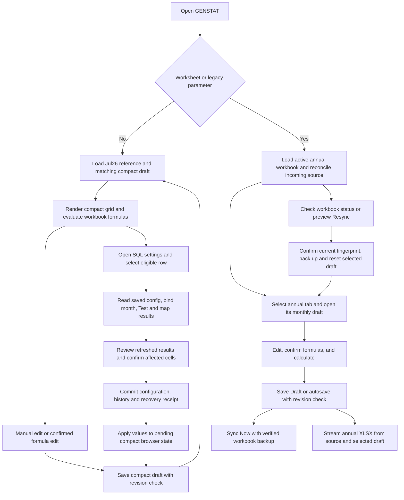

# GENSTAT current status and system flow inspection

18 November 2026 · Asia/Manila

## 1. Executive summary

**Requires fixes before deployment.** GENSTAT has a July compact report with reviewed SQL overlays and a separate annual Excel editor with monthly drafts, synchronization, and export. Seven read-only regression suites, all source syntax checks, live reporting grants, July SQL execution and cell mapping, and five workbook-package checks passed. Browser interaction and mutation paths were inspected in source. The previous cleanup report records a successful isolated full regression run.

The live row 18 configuration adds cancelled KWH to Sales + Diff, contrary to the total specified for this inspection. The saved adjustment query also uses the sales area mapping where the two available mapping columns differ for 43 July Post-Sales matches. The compact SQL result has no path into annual Excel export. Deployment access control also needs verification and hardening because the application issues edit and SQL settings permissions to browser sessions without requiring a user identity.

## 2. Inspection scope and methodology

Inspected first-party PHP, JavaScript, compiled and source CSS, package manifests, migration SQL, workbook parts, draft metadata, Git history, local Apache configuration, live database metadata and grants, and the saved reports. Ran fixture-free CLI tests, direct workbook reads, and prepared SELECTs against the configured reporting reader. For stored SQL, manually reviewed both definitions before executing them in a read-only transaction and separately exercised the application's mapping functions in memory. The PHP parser bridge uses temporary files, so its Node parser was tested directly.

No HTTP route was opened, since PHP sessions and annual startup can write files or promote an incoming workbook. No workbook, SQL definition, source file, grant, or environment setting was changed. This report is the sole created file. Runtime results below refer to checks actually executed for this inspection. Earlier browser results are identified as historical.

## 3. Current Git status

| Item | Observation |
| --- | --- |
| Branch and initial worktree | `main`, clean index and worktree, with `origin/main` as upstream. This report is the only subsequent untracked file. |
| Latest commit | `302b53da8ccf917df415d57451decc5bbe9f5abf`, Complete GENSTAT cleanup and stabilize reporting system. |
| Remote | `origin` uses `https://github.com/rjepoy002/genstat.git` for fetch and push. `git ls-remote origin refs/heads/main` returned the exact local HEAD hash. |
| Main branch history | `302b53d` follows `81c4456` (pre-MySQL baseline) and `e7bb30e` (initial project). The cleanup reports and implementation are grouped in `302b53d`. No separate Batch A, B, C or final-cleanup commit appears on the main branch. |
| Legacy inventory | The old formula password library, CLI, and compatibility test remain deliberately. The historical README section and old exploratory scripts contain superseded instructions. Four SQL test entrypoints and `tests/ui.cjs` are active compatibility aliases. |

## 4. Project architecture

Plain PHP renders both interfaces on Apache/XAMPP. Browser JavaScript calls same-origin JSON endpoints. Compact SQL operations use mysqli against MariaDB and launch a Node SQL parser subprocess. Excel reads and writes use the application's ZIP and OOXML code, PHP DOM/XPath, and zlib. PHP's workbook formula evaluator and the BCMath SQL-row expression evaluator are separate. There is no frontend framework, spreadsheet vendor library, or build step for the PHP renderer.

## 5. Directory and file responsibilities

| Path | Responsibility |
| --- | --- |
| `index.php:4–7` | Default dispatch to compact report. Sheet and legacy query parameters select annual rendering. |
| `base-report.php:6–54`, `assets/base-report.js` | Compact view, per-cell formula editing, recalculation, draft save, and SQL overlay handoff. |
| `api.php`, `assets/app.js` | Annual open, save, formula confirmation, export, synchronization, status polling, and Resync. |
| `query-settings-api.php`, `partials/sql-settings.php`, `assets/sql-settings.js` | Modal, SQL metadata, Test, Review, Apply, History, Disable, and recovery. |
| `lib/query-settings.php`, `lib/query-apply-save.php`, `lib/report-areas.php`, `lib/report-expression.php`, `lib/sql-replacements.php` | Parser/executor, transactions and receipts, area matching, decimal expressions, signed overlays. |
| `lib/xlsx.php`, `tools/build-layout.php`, `lib/render.php`, `lib/workbook-policy.php`, `lib/formula-engine.php` | OOXML parsing, worksheet metadata, styles/number formats, cell protection, and bounded evaluation. |
| `lib/app.php`, `lib/formula-edits.php`, `lib/workbook-storage.php`, `lib/template-sync.php`, `lib/sync-mapping.php`, `lib/workbook-resync.php` | Draft lifecycle, export packaging, incoming validation, coordinate migration, and rollback paths. |
| `config/`, `storage/`, `excel-files/`, `genstat.xlsx` | Baseline, input rules, local database settings, drafts/caches/locks/signing state, workbook lifecycle folders, and source fallback. |
| `migrations/`, `tools/`, `tests/`, `docs/` | Four settings schema migrations, operator tools, 31 canonical suites and historical fixtures, and implementation records. |
| `assets/tailwind.input.css`, `assets/tailwind.css`, `assets/base-report.css`, `assets/app.css` | Tailwind input and generated output, compact grid CSS, annual stylesheet. |

## 6. Complete system workflow

| Stage | Entry, validation and result |
| --- | --- |
| Open and route | `index.php:4–7` selects compact by default or annual by `sheet` or `legacy`. Each starts a PHP session and issues a CSRF token. Invalid annual worksheet names cause a 503 error page. |
| Establish period | `lib/base-report.php:9–17` requires first reference worksheet Jul26. `qs_month()` converts it to 202607. `index.php:33` maps Jan–Sep 2026 names, with June fallback for auxiliary sheets. `lib/app.php:46` only accepts 2026-01 through 2026-09. |
| Load workbook | Compact parses `excel-files/reference/GENSTAT_BASE.xlsx`. Annual `layout()` checks the lock and recovery marker, assesses incoming workbooks, and reconciles against the cached layout and configured baseline. The preferred source is `excel-files/active/genstat_2026.xlsx`, with root `genstat.xlsx` as fallback. |
| Render and retrieve values | Compact validates the hash-keyed JSON draft and renders the calculated A8:S47 slice. Annual computes geometry and calls `api.php?action=open` to get draft and formula results; state is keyed by reporting period and sheet. SQL settings are fetched on modal open. Report startup retrieves no reporting values from SQL. |
| Request SQL | `query-settings-api.php:13–37` loads configuration and area metadata. Result inspection runs a bounded prepared SELECT. Test uses the session result and mapping, while Review reruns the chosen query and binds the proposal to current inputs, source, area metadata and configuration. |
| Evaluate and edit | Source formulas expand shared references through `expanded_formulas()`. `FormulaEngine` calculates the supported subset and preserves cached external/unsupported source values with warnings. Manual formula changes need explicit per-cell confirmation. SQL row 18 may replace eligible formula cells after separate authorization. |
| Save | Compact Save Draft uses the latest revision and a lock. SQL Apply & Save commits configuration/history/receipt and returns amended browser state. A separate compact Save Draft persists the applied values. Annual changes are saved by button or eligible autosave; persisted edits can be undone through a revision-aware save. |
| Refresh and reconcile | Compact reload restores its saved draft. Annual GET status and initial layout can perform incoming reconciliation and update cache. Sync Now first saves pending edits, then publishes the annual draft to Excel with backup. Resync previews the existing active file and requires a fresh fingerprint-bound confirmation before backing up and discarding the selected draft. |
| Export | Annual browser saves pending edits and GETs `api.php?action=export`; server reads the selected annual draft and streams an XLSX assembled from the active workbook. Compact SQL values have no export route. |

The two save steps after SQL review and the two report sources are the main workflow discontinuities. SQL definitions can be enabled without a saved compact draft, and the annual export cannot consume that draft. Annual GET status also has side effects, which complicates monitoring and inspection.

## 7. Mermaid workflow diagram

## 8. Excel template and formula handling

- OOXML relationship names identify worksheet parts. The reader extracts dimensions, styles, shared strings, values, formula attributes, merges, comments, defined names and links. The raw active workbook has ten tabs, January through September 2026 plus RecovBill26. Its package starts with RecovBill26; `sync_reconcile()` preserves baseline ordering, and the observed ready cache starts with Jun26. `tools/build-layout.php:13–58`, `lib/sync-mapping.php:61–65`.
- The incoming workbook passed package validation and contains only January through August plus RecovBill26. September exists in active and has a revision-8 draft. The missing-month branch preserves the active sheet and draft and leaves incoming pending for operator review. The annual guard has no general new-year registry or worksheet generation pathway. `lib/workbook-storage.php:30–56`, `lib/monthly-worksheets.php:5–12,51–76`.
- Annual manual edits accept writable labels, blanks, values and supported formulas. Existing formulas and saved formula overlays require per-cell authorization. Array/data-table ranges and covered merge cells remain restricted. Compact manual formula edits use their own session grants and expression validation. SQL replacement is enabled only for the approved row 18 and permitted ordinary or shared anchors, subject to signed template, cell and value provenance. Calculated/hidden rows outside eligible targets are protected from SQL. `lib/formula-edits.php:5–29`, `lib/formula-confirmation.php:6–28`, `base-report.php:13–35`, `lib/sql-replacements.php:12–58`.
- The compact source calculation completed with two warnings and zero errors. Unsupported/external source expressions may retain cached values. Excel still retains the full formulas. June AC31 and AC38 and the invalid defined name `ok` are documented source limitations in the annual view. This browser engine is bounded and uses floating-point workbook arithmetic; the SQL expression evaluator uses BCMath. `lib/formula-engine.php:46,111–133`, `lib/report-expression.php:21–52`, `index.php:54`.

## 9. Report table behavior

The compact model derives its range from the Particulars header and bottom report description. The B:P area columns precede totals/comparisons. The render retains source merge and style information where represented, while the browser applies compact sizing and formatting. The read-only test preserved all 402 source formulas and 96 database-designated input classifications. That formula count covers the source worksheet; the compact rendered range contains fewer. `lib/base-report.php:9–37`, `base-report.php:38–52`, `lib/render.php:17–102`.

| Hidden Excel row | Description |
| --- | --- |
| 19 | Total KWH Sold (w/o BILL ADJ) |
| 34 | Dist. System Loss In KWH - ADJ |
| 37 | Rate of Dist. System - ADJ |
| 46 | System Loss in KWH - ADJ |
| 47 | Rate of System Loss - ADJ |

The five exact rows were verified; tests demonstrated downstream recalculation through B19, B34, B46 and B47. Hiding is a compact HTML display rule, with the source workbook rows retained and available to calculation. Annual exports preserve their own worksheet rows and existing hidden flags; no compact export carries these UI hide rules. `lib/base-report-view.php:5–14`, `tests/base-report-view.php:6–22`.

Sticky headers/columns and internal scrolling are implemented with CSS in compact and scroll/zoom handling in annual. Compact fits within a minimum readable font size and uses horizontal scrolling at narrow widths. Earlier browser verification covered 1920×1080, 1600×900, 1366×768, 1280×720 and 390×844 for compact and desktop/tablet/mobile annual controls. Current visual behavior was not rerun. Save Draft and status indicators exist in both; Undo/Redo, Sync Now and Resync are annual features. `assets/base-report.css:8–17`, `assets/base-report.js:10–26,54–60`, `assets/app.js:175–186,237–249`.

## 10. SQL settings workflow

The gear opens the native Tailwind-styled dialog. Metadata supplies eligible rows, saved configurations, area data and recoverable operation state. The editor runs result inspection, offers automatic and explicit bindings, validates on Test, and presents proposed current/value/difference and protection details. Apply remains gated by Test and Review, proposal age and fingerprints, standard confirmation and an extra formula replacement confirmation where required. Success feedback distinguishes saved configuration from pending values. Failure handling includes mapping messages, stale-review feedback and retry/recovery instructions. `partials/sql-settings.php:8–53`, `assets/sql-settings.js:48–89`, `query-settings-api.php:22–99`.

The separate Save Configuration button and Query Identifier field are absent. The endpoint rejects standalone `save`. **History is still visible** and supports Restore Configuration and Disable Configuration. Internal identifiers remain for legacy record linkage and stable row identities. Configurations and receipts survive reload; unsaved report overlays disappear from the page on refresh unless explicitly saved or recovered from the initiating session. Identical config saves avoid redundant history and existing revision checks prevent overwriting changed mappings. The observed compact draft has revision 1, one ordinary value and zero signed replacements, including no persisted F18 SQL override. `query-settings-api.php:39–50,73–94`, `lib/query-settings.php:145–162`, `lib/query-apply-save.php:14–55`.

## 11. SQL security and database access

The local reader and writer come from `config/query-settings.local.php`. Live reader grants are global USAGE and SELECT on exactly `area_master`, `area_mapping`, `kwh_diff_allocation`, `billadjustment`, `overallsalessummary`, `billhistorycancelled` and **`billhistorycancelled_2`** in `genstat_db`. SELECT worked for each. The writer has SELECT/INSERT/UPDATE on definitions, mappings and history, and SELECT/INSERT on receipts. Reporting grants exclude modifications and grant delegation. The monthly source probe uses a separate administrative configuration discussed in section 21.

The browser POST carries CSRF and source hash. `tools/validate-report-sql.cjs:5–40` combines token restrictions and MySQL AST traversal to permit one SELECT or WITH SELECT, restrict tables/functions and reject comments, hints, multiple statements, files, locks, variables and cross-schema access. `lib/query-settings.php:40–70` runs the parser with a five-second validation bound, prepares bound month placeholders, uses a MariaDB read-only transaction and statement timeout, and limits preview to the configured 500 rows, 40 columns, 4,096 bytes per field and 1 MB of field data. Unexpected SQL Settings errors expose generic messages and log class/code; explicit validation errors are returned to the user. `tools/verify-reporting-access.php` still checks allowlist equality, grants through `qs_db()`, SELECT on each table, and applicable saved queries. This inspection used equivalent grant and table probes plus direct stored SELECT execution rather than its temp-file parser bridge.

## 12. SQL result mapping

`report_area_headers()` joins merged-aware heading fragments until the first data label and stops at the total column. `report_area_alias()` centralizes Brooke's Point spelling variants and verifies AreaID 12 against live master and GENSTAT mapping data. `qs_auto_bindings()` then uses selected result identifiers/names and matching mode. `qs_match()` checks known IDs, optional secondary SACode, required columns, missing expected results, duplicate keys, explicit exclusions and eligible targets. Null/non-numeric/non-finite results fail; zero is accepted. Decimal strings and high-precision DOUBLE text pass through mapping; Excel display follows target formatting. `lib/report-areas.php:4–38`, `lib/report-expression.php:53–91`, `lib/query-settings.php:76–94,110–140`.

| Columns | Observed headings and saved target IDs in both rows |
| --- | --- |
| B–F | Main 1, Aborlan 8, Narra 9, Quezon 10, Brooke's Point 12 |
| G–K | Roxas 2, Taytay 5, Balabac 15, Araceli/Dumaran 4, San Vicente 3 |
| L–P | El Nido 6, Cagayancillo 19, Cuyo/Magsaysay 16, Agutaya 18, Rizal 11 |

Both July configurations returned 15 distinct AreaIDs and mapped to 15 targets with zero errors. The compact model joins Brooke's and Point into F, and F18 is a formula replacement target. G18 is ordinary. The in-memory mapper produced F18 = 3,780,899, while F25 mapped to −2,290. The combined headers J and N use explicit single area IDs and there is no simultaneous binding to both constituent names; verify that the upstream aggregation matches that business intent. The selected rows currently use AreaID-only bindings. Live mapping data showed no GENSTAT area with multiple SACodes and no ambiguous SACode/Area-to-GENSTAT pair. SQL uses different mapping logic from the workbook resolver because aggregation occurs before results reach PHP.

## 13. KWH query and allocation verification

Two enabled database records, `sales_kwh` and `adj_kwh`, contain the same trimmed SQL. No stored definition is named `genstat_kwh`, and no authoritative version was available for identity comparison. Both copies returned the same 15 July rows. Their enabled consumers are Jul26 A18 (calculated Total KWH Sold) and Jul26 A25 (KWH_Diff).

| Rule | Actual saved behavior and evidence |
| --- | --- |
| Sales_KWH | Filters `overallsalessummary.BillMonth`, joins distinct SACode and Area, sums by SACode plus GenstatAreaID, then floors and casts to DECIMAL(18,2). No upward rounding. Result has two decimal digits in preview despite the requested zero-digit Sales display. The current row consumes a total and the compact workbook cells have independent display formats. Sales never joins allocations. |
| KWH_Diff | Filters `billadjustment.BillMonthRef` and trimmed Post-Sales type, sums KWH minus ASBKWH, truncates to two decimals at the SACode/area source, then aggregates at destination. The join groups by GenstatAreaID and never reads kwhdiffAreaID. Twelve mapping rows disagree between those IDs and 43 July source matches meet that discrepancy. The correct destination impact requires reconciliation against the approved mapping. |
| Allocations | Latest month at or before the report month wins per source. Unconfigured sources self-route. Destination sums combine source contributions. Observed configuration has only July 202607 rules 2→2, 4→2 and 19→2. Older monthly rows can coexist under the monthly/source key; live carry-forward across multiple stored months could not be observed. |
| Output grain | The final output is one SACode/GenstatAreaID row per pair, with allocated Diff joined by AreaID alone. If the same AreaID occurs under multiple SACodes, the destination Diff can repeat in the output. July returned no duplicates, so this remains a code-inspected future-data risk. Flooring by SACode could also diverge from flooring after a combined area sum. |
| Total KWH Sold | The SQL column is Sales_KWH + KWH_Diff, with cancelled quantities supplied separately. A18 has an enabled expression that adds Total_Cancelled_KWH. Six July areas had a nonzero cancelled sum. Brooke's Point returned Sales 3,778,736, Diff −2,290 and cancelled 4,453. The SQL total is 3,776,446, while the application mapper proposed 3,780,899. No report apply or save was performed. |

## 14. Saving and persistence

| State | Location and safeguards |
| --- | --- |
| Compact manual/SQL values | `storage/base-report-<template hash>.json`, keyed by reference, with formula overlays, signatures, revision and SQL history. Lock plus optimistic revision and atomic replacement. Existing saved values are loaded on refresh. |
| Settings | Four `genstat_query_*` tables handle definitions, row mappings, histories and receipts. Transaction and operation ID prevent repeated commits; failed receipt insert rolls back. Recovery checks initiating session, current draft/hash and configuration. |
| Annual edits | `storage/draft-<period>[--sheet hash].json`, with template hash, revision, source-cell evidence, formula audit and timestamps. Open projects older coordinates when compatible. Observed June revision 5 and September revision 8. |
| Period and view state | Annual period derived from the selected worksheet, with sheet in URLs and draft keys. Compact period derived from template. Annual zoom uses sessionStorage. Undo history is in memory and can submit a persisted inverse edit subject to revision/authorization. |
| Workbook and sync state | Active/incoming/archive/backup folders and `storage/template-auto.json`, `workbook-sync.json`, locks, and recovery marker. Content fingerprints, verification and backups are checked before synchronization and Resync. Errors avoid a success message. |
| Export state | Annual draft and workbook are read and the XLSX response is generated in memory. The browser downloads it; there is no saved compact-export artifact path. |

The SQL database transaction and filesystem draft save are separate. A successful configuration commit can outlive unpersisted values, and same-session receipt recovery is conditional. Annual autosave and manual Save Draft share the same endpoint; the browser busy flag and revision checks coordinate them. Resync discards only the selected draft after rechecking the active file and backing up the previous state. `base-report.php:25–33`, `lib/app.php:55–77,97–127`, `lib/workbook-resync.php:15–76`.

## 15. Excel export

`assets/app.js:80` saves dirty annual edits first and requests export for the selected sheet/period. `api.php:40` streams the workbook. `lib/app.php:79–94` patches selected worksheet cells through relationship-derived paths, and `lib/formula-edits.php:63–101` updates formulas/caches and recalculation metadata. Unrelated sheet XML, formatting and links are intended to be preserved. External workbooks can still be necessary for recalculation.

Reopened and validated the active and reference packages and two existing historical exports, `tests/exported.xlsx` and `tests/ui-export.xlsx`; both exports were valid packages containing Jun26. No new XLSX was produced and desktop Excel was not launched. Earlier isolated tests compared new exports to their source. Current export cannot include the mapped compact SQL values, compact-only hidden-row presentation, or compact formula replacements. An annual export of Jul26 is an export from the annual source with the annual July draft.

## 16. Frontend architecture

Tailwind CSS and CLI are pinned to 4.3.0, built locally with `npm run build:css`. Tailwind styles the SQL modal and supports compact header utilities. Compact and annual use separate CSS and plain JavaScript. Compact uses delegated grid events, a mutable overlay and pending recalculation; SQL dialog holds test/review/receipt state and uses native modal focus. Annual uses per-cell listeners, separate formula-reference and highlight modules, a bounded edit-history module, and request/notification states in `assets/app.js`. Compact reports status in the page and uses native confirmations. Annual uses dialogs, status banners and an expandable warnings panel.

Separate toolbar/grid styling and formula-confirmation implementations increase maintenance cost while reflecting different routing and persistence. Compact and annual typography and controls differ, but no conflicting handler or unused dependency was proved by current inspection. The parser dependency is runtime and Tailwind dependencies are build-time. Historical screenshots/tests and CSS notes are poor evidence of present selectors. No CSS coverage or browser event profiling was performed.

## 17. Cleanup verification

| Phase and evidence | Classification |
| --- | --- |
| Initial inspection, `docs/cleanup-inspection.md` | **Verified complete.** Inventory is committed. Current source distinguishes the two entry flows and supports the high-risk preservation decisions. Some historical observations describe older code. |
| Batch A, `docs/batch-a-cleanup.md` | **Verified complete.** Old password unlock functions are absent from executable code; legacy status and CLI remain. Refresh and live app imports use current confirmation. |
| Batch B, `docs/batch-b-refactoring.md` | **Verified complete.** Current Apply/receipt logic and styled modal are present, compatibility entrypoints resolve once, and the old standalone save action is rejected. |
| Batch C inspection, `docs/batch-c-inspection.md` | **Verified complete.** Annual renderer, synchronization, status table, and compatibility group remain. Conditional removal was tracked independently. |
| C2 Phase 1, `docs/batch-c2-phase1-cleanup.md` | **Verified complete.** Two retired SQL helper files are absent and executable imports were not found. The current isolated lifecycle helper remains and historical documentation retains references. |
| C2 Phase 2, `docs/genstat-final-cleanup.md` | **Verified complete within approved scope.** Manifest has 31 unique suites, README identifies current behavior, legacy retirement is explicitly deferred, and committed artifact reports previous isolated full-suite pass. Application source and prior supported routes remain present. |

## 18. Error handling and reliability

| Scenario | Inspected handling |
| --- | --- |
| Database down, parser fails, SQL rejected | SQL Settings emits controlled validation or generic operator feedback. Failed operations do not promise save. Annual workbook-only operation can continue, although the monthly data probe can report unavailable. |
| Empty query, incorrect mapping, null result | Missing expected targets, unknown/duplicate IDs and invalid values block validation or review. An empty or unchanged review cannot authorize an applicable save. |
| Missing sheet/workbook or invalid month | Missing annual sheet produces 503 at render and 400 at API. Missing/invalid source causes verified-layout warning or guarded failure; broken source should not be published. Invalid period and template/source versions stop writes. |
| Unsupported formula | Invalid user overlays are rejected. Unsupported or unavailable external source calculation can use original cached value with warning. Root workbook formula defects are retained. |
| Permission or failed save/export | Locks, validation and atomic replacement throw errors. Browser reports failures. Sync and Resync back up state and attempt rollback; abrupt termination across several file writes is residual risk. |
| Network interruption and duplicate apply | Receipt keyed by operation ID, transaction rollback and same-session recovery. Separate draft persistence remains necessary. Compact lost Save Draft response can require a refresh/reopen before a retry; annual version conflicts require reload. |
| Incoming worksheet omissions | Single candidate lacking a month is held for review; detected September omission entails no observed removal or write during this inspection. |

## 19. Test results

PHP commands below use `C:/xampp/php/php.exe`. Syntax checks used repository-owned source files and excluded Git internals and installed dependencies. Every reported pass here was executed under the current inspection.

| Command or read-only check | Result and relevant evidence |
| --- | --- |
| `php -l <file>` for each PHP file | 65 passed, zero errors. |
| `node --check <file>` for each JS/CJS file | 35 passed, zero errors. |
| `php tests/base-report-view.php` | Pass. Exact hidden rows, formulas, immutable source, dependency calculations. |
| `php tests/brookes-point.php` | Pass. Live area metadata with reversed fixture rows, alias invariants, duplicates, and target protection. |
| `php tests/editing-policy.php` | Pass. Merge and array rules, implicit blanks, coordinate migration and unchanged draft fixture. |
| `node tests/edit-history.cjs` | Pass. Undo/Redo ordering, 50-edit bound and branch invalidation. |
| `node tests/formula-references.cjs` | Pass. Workbook/sheet/A1 reference parsing and malformed expressions. |
| `node tests/query-parser.cjs` | Pass. Supported SELECTs, exact allowlist, and rejection of disallowed forms. |
| `node tests/test-runner.cjs`, `node tools/run-tests.cjs --list` | Pass. Aliases deduplicated and 31 canonical suites listed. |
| `php` reading inline SELECT probe on stdin | Pass. Live grants and seven SELECTs verified through `qs_db()`. Two stored SQL definitions executed with a prepared 202607 parameter, 15 rows each; `qs_normalize()` and `qs_match()` accepted both mappings. Business parity failed for the A18 total rule. |
| `php` reading inline package probe on stdin | Pass. `workbook_validate()` reopened active, reference, incoming and two historical exports. Compact model produced A8:S47 with zero calc errors and two warnings. |

The full runner, browser scenarios, PHP parser wrapper and workbook/export mutation suites were skipped because they create fixture files, sessions, screenshots or database objects. Live HTTP startup was skipped because it can reconcile the pending workbook. The earlier 31-suite isolated run is historical evidence. [Final cleanup regression results](genstat-final-cleanup.md)

## 20. Performance findings

- Observed single CLI read measurements on this machine were approximately 197 ms for compact validation plus parsing, 1,462 ms for annual validation plus parsing, and 222 ms for compact model plus calculation. These measurements exclude Apache, network, browser paint, concurrency and warm-cache effects. No production latency fault was established.
- Compact requests rebuild the workbook layout and calculation repeatedly. SQL actions reload settings and areas, and Test/Review use distinct steps with Review rerunning data for freshness. Each parser invocation starts Node. The apply path acquires locks over whole definitions and mappings tables, with another lock/read in `qs_save()`. These raise concurrency costs if the installation grows. `base-report.php:9–24`, `query-settings-api.php:12,62–73`, `lib/query-settings.php:40–47,145–147`.
- Annual status polls every ten seconds for visible tabs. Layout caching limits extraction, while hashing, cache decode, a request-wide lock, full visible-grid rendering and in-memory ZIP export can become bottlenecks with larger workbooks or more users. Profile before changing synchronization or caching. `assets/app.js:243–249`, `lib/template-sync.php:26–42`, `lib/app.php:32–37,79–94`.

## 21. Security findings

| Severity | Finding |
| --- | --- |
| Critical before shared exposure | Neither compact nor annual web flow requires an identified user or role. Session CSRF prevents cross-origin submissions, and per-cell confirmation controls editing intent. Any client allowed to reach the app can obtain its own session and use the supported editing or SQL administration workflow. Apache is listening on wildcard addresses on port 80. Firewall, proxy and effective external access controls were not tested, so remote reachability is unverified. |
| High | Tracked `config/monthly-source.php` configures a local administrative MariaDB account with an empty password field. The runtime monthly probe only reads metadata and counts but uses that identity. MariaDB also has a wildcard listener; remote grants, firewall behavior and real remote access were not tested. Use a least-privilege monthly reader and separate installation credentials. |
| Medium | Annual and compact endpoint exception handling can expose raw error text on certain failures; the SQL settings endpoint sanitizes unexpected exceptions. Production HTTP error and log configuration was not verified. |
| Medium | Apache denies access to config, storage, workbook, test, library and tool directories through their `.htaccess` files. Root rules deny selected extensions. Preserve and validate these denials on the deployment document root, including Git metadata and directories outside those rules. The inspection did not probe public URLs. |
| Verified controls | Read-only reporting grants and SQL parser tests. Code inspection also found source/revision validation, CSRF, scoped formula grants, HMAC signing, escaped PHP/HTML output, JSON hex encoding, fixed source paths, and incoming package/part/size/CRC checks. Incoming files are filesystem drops rather than an HTTP upload endpoint. |

## 22. Feature status matrix

“Working” here requires a successful current check of the named behavior. “Partial” identifies an observed limit or mismatch. Historical browser passes do not certify current runtime behavior.

| Feature | Status | Main Files | Findings |
|---|---|---|---|
| Report loading | Partial | `index.php`, `base-report.php`, `lib/base-report.php` | Compact layout loads in CLI and annual package is valid. Current HTTP render unverified. |
| Excel template processing | Working | `tools/build-layout.php`, `lib/workbook-storage.php` | Current packages parsed and validated. New year and missing-month generation are unsupported. |
| Formula handling | Working | `lib/formula-engine.php`, `lib/workbook-policy.php` | Hidden dependencies and protection checks passed for inspected fixtures. Full Excel parity and browser confirmations unverified in this inspection. |
| Report editing | Unverified | `base-report.php`, `api.php`, `assets/app.js` | Implemented both views. No browser edit attempted. |
| Save functionality | Unverified | `lib/app.php`, `base-report.php` | Existing drafts readable; write and concurrency paths source-inspected and historically tested. |
| Undo | Partial | `assets/edit-history.js`, `assets/app.js` | In-memory history passed. Persisted inverse and browser shortcut behavior not rerun. Annual only. |
| Resynchronization | Unverified | `lib/workbook-resync.php`, `api.php` | Version-bound confirmation and rollback inspected. No state-changing test. |
| SQL settings | Unverified | `partials/sql-settings.php`, `assets/sql-settings.js` | UI and History present. Modal behavior not rerun. |
| SQL validation | Working | `tools/validate-report-sql.cjs`, `lib/query-settings.php` | Parser suite and live grants passed. Full PHP endpoint path not run. |
| SQL review | Partial | `query-settings-api.php`, `lib/query-settings.php` | Live results mapped in memory. Proposal issuance and browser confirmation not rerun. |
| SQL apply | Partial | `query-settings-api.php`, `assets/base-report.js` | Config commit and separate value save are implemented. Apply does not itself persist report values. |
| Configuration persistence | Partial | `lib/query-settings.php`, `lib/query-apply-save.php` | Two enabled persisted rows read. Write, rollback and receipt paths historically tested only. |
| Area mapping | Working | `lib/report-areas.php`, `lib/query-settings.php` | 15 live targets per configured row and Brooke's Point regression passed. Business intent of combined headers requires confirmation. |
| KWH calculations | Broken against requested rule | `genstat_query_definitions`, `genstat_row_query_mappings`, `lib/report-expression.php` | Observed A18 cancelled addition and use of sales grouping for Diff. |
| KWH allocation | Partial | Stored query CTEs, `kwh_diff_allocation` | Latest-month fallback logic exists and July rows returned. Source mapping discrepancy and prospective multi-SACode duplication remain. |
| Excel export | Partial | `api.php`, `lib/app.php`, `lib/formula-edits.php` | Historical exports reopened. Fresh export not executed. No compact SQL value export. |
| UI responsiveness | Unverified | `assets/base-report.css`, `assets/app.css`, `assets/tailwind.css` | Historical browser passes. Current desktop/tablet/mobile visuals not rerun. |
| Security controls | Partial | `api.php`, `query-settings-api.php`, `lib/sql-replacements.php`, `.htaccess` | Reader isolation passed; no app authentication or role gate located. |

## 23. Prioritized issues

| ID / severity | Evidence and reproduction | Impact and proposed resolution |
| --- | --- | --- |
| KWH-01 · Critical | Read enabled A18 mapping and prepare saved SQL for 202607. Pass rows through `qs_record_config()` and `qs_match()` at `lib/query-settings.php:110–143`. F18 proposes 3,780,899 against the SQL and specified total of 3,776,446. | An operator can apply the wrong total for six observed areas. Confirm business cancellation policy against authoritative July totals and approve the mapping expression before using the values. |
| KWH-02 · High | Current SQL CTE `adjustments` uses GenstatAreaID. SELECT Post-Sales July rows joined to mismatched mapping IDs returns 43 matches. See section 13. | Adjustment attribution and allocated destinations can differ from approved KWH difference areas. Reconcile source-to-destination totals using kwhdiffAreaID and confirm the contract with the canonical query owner. |
| SEC-01 · Critical if exposed to untrusted users | `index.php:4–7`, `api.php:3–34`, `query-settings-api.php:3–13`, `base-report.php:6–22`. Session, CSRF and confirmations are present; no user/role gate found. Wildcard port 80 listening observed. | An allowed HTTP client can use shared write and query workflows. Verify network isolation and authenticated operator roles before shared deployment. |
| SEC-02 · High | Tracked `config/monthly-source.php`, consumed by `lib/monthly-worksheets.php:20–39`. Administrative connection configuration confirmed without printing credentials. | A read-only probe carries unnecessary privileges. Provision a dedicated monthly metadata/data reader and use local secret configuration. |
| EXP-01 · High | `api.php:40` reads only annual draft and compact `base-report.php` has no export action. Verified through source routing. | An exported annual workbook omits compact reviewed SQL values by design. Decide whether the deployment requires a compact SQL-populated artifact and specify its workbook contract before implementing. |
| SAVE-01 · Medium | `query-settings-api.php:91–94` returns `draftPending`; `assets/base-report.js:54–60` handles separate save. Observed configured rows coexist with no saved SQL replacements. | Users may assume Apply & Save persists values through refresh. Keep the two phases explicit and validate the expected persistence contract with operators. |
| ALLOC-01 · Medium | Saved CTE groups Diff by destination AreaID and joins it to output rows keyed by SACode and AreaID. No duplicate AreaID was observed for July. | Later mapping changes can duplicate destination Diff. Add multi-SACode and historical carry-forward tests against the approved output grain. |
| WB-01 · Medium | Incoming package lacks Sep26 while active and saved draft retain it; `lib/workbook-storage.php:45–56` defers the intake. | Incoming workbook cannot replace active through this path. Confirm intended September data and workbook before intake. |
| PERF-01 · Medium | Repeated ZIP parse, requests, polling and broad SQL locks identified in section 20. | Potential contention and memory pressure over multiple sessions. Profile a representative deployment before tuning. |
| UI-01 · Low | `partials/sql-settings.php:12–14` displays History. Sales DECIMAL(18,2) differs from the requested zero-digit display. | Contract/UI mismatch. Keep recovery features available until History requirements are agreed and confirm where whole-number sales presentation is required. |

## 24. Recommended next development phase

Use a deployment-readiness phase focused on existing workflows. First, obtain the authoritative KWH definition and reconcile July totals and per-area adjustment allocations, starting with Brooke's Point, Roxas, and the combined-area columns. In parallel, establish and verify application access controls and least-privilege monthly database access. Then settle whether operators require compact SQL-populated Excel export and durable values in the same apply workflow. Verify these decisions through isolated browser and workbook round-trip tests, including recovery, carry-forward across months, a multi-SACode area and reopening with desktop Excel. Keep the pending incoming September discrepancy in the operating checklist.

## 25. Overall project readiness assessment

**Requires fixes before deployment.** The implementation is ready for controlled development and testing. Current evidence verifies a usable workbook/model foundation, query allowlist, read-only reporting grants and live July result mapping. The incorrect configured total, unresolved adjustment attribution, deployment access-control gaps and missing compact-to-Excel value path prevent deployment sign-off under the requested workflow. Historical browser coverage remains relevant, and current browser writes, actual network exposure and desktop Excel recalculation remain unverified. This inspection implements no fixes.
