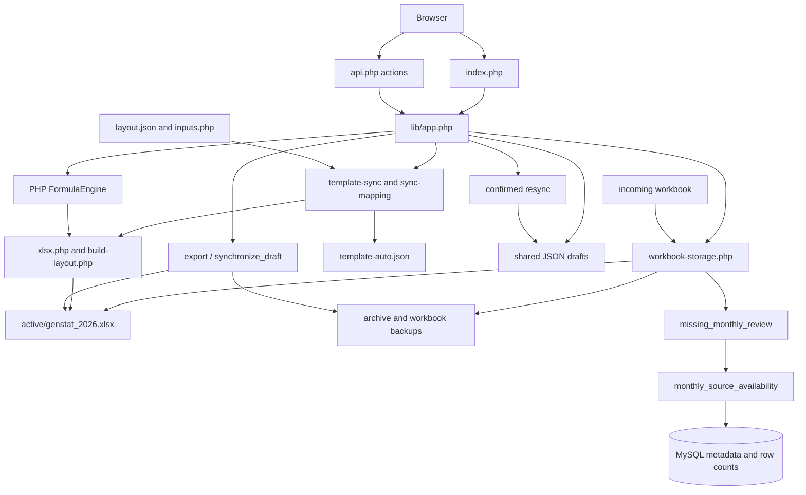

# GENSTAT Full System Inspection

Inspection: 13 November 2026, Asia/Manila. Project: `C:\xampp\htdocs\genstat`.

Scope: current working tree, local workbooks, tests and read-only local `genstat_db` metadata/diagnostics. Only this report was created. No application, workbook, draft, database record, dependency or Git branch was changed. No application HTTP requests were made: page loads and GET status endpoints can promote incoming files and write caches/backups.

Final filesystem verification: a before/after content-hash inventory showed all enumerated non-report files unchanged except `storage/draft-2026-06.json`, which changed during the inspection interval. No inspection command invoked a draft writer or application HTTP endpoint; the cause is undetermined and may be another active session/process. The draft was not restored or overwritten. The initial June observation was revision 3 with no overrides; the final observation was revision 5 with one value override, saved at 13:28:23 Asia/Manila on 13 November 2026. Findings describe observations at the stated check times, not a frozen production snapshot. The statement above about unchanged artifacts refers to actions performed by this inspection, not an assertion that no other process changed the workspace.

**Evidence terminology:** Confirmed = directly observed source/file/query/check result. Unverified = code exists but its full runtime workflow was not exercised. Risk = credible failure path, not an observed incident. Missing = no implementation found. All paths below are relative to the project root; named functions provide evidence locators. Existing test transcripts are historical evidence, not current test results.

## A. Executive Summary

GENSTAT is a substantial custom PHP/JavaScript Excel viewer/editor with JSON draft overlays, a bounded PHP formula interpreter, automatic request-driven template reconciliation, export, browser-to-Excel synchronization and confirmed resync. It is not yet a database-driven GENSTAT reporting system.

Safe checks verified workbook validation/extraction, cached-layout reconciliation, existing-draft projection, formula protection classification, in-memory value/formula evaluation, decimal display, formula-reference parsing and undo history. Browser save/unlock/resync/replacement workflows were traced but deliberately not executed.

Local MySQL connectivity works. Application integration only probes schema and row availability in two source tables. Mapping/allocation tables exist with records and constraints but have no application consumers. No canonical `genstat_kwh` SQL was found. Approved KWH calculation and MySQL-to-Excel value synchronization are absent. “Sync Now” publishes browser drafts to Excel; it does not retrieve calculated database values.

Major concerns: existing workbook `#REF!` formulas and downstream errors; reporting periods limited to January–September 2026; missing approved calculations/mappings; multi-file sync recovery after abrupt termination; stale cached formula results; and confirmation-based formula unlocking without operator roles. These do not establish that an implemented database KWH query produces incorrect totals: that query is absent.

## B. Repository Overview

### Git and structure

- Branch `main`; recent history contains one commit: `e7bb30e Initial GENSTAT project`.
- Origin: `https://github.com/rjepoy002/genstat.git`. No fetch/push/checkout/remote comparison; remote parity is unknown.
- Pre-existing modified paths: `CELL-EDITING-FIX.md`, `README.md`, `api.php`, `assets/app.css`, `assets/app.js`, `excel-files/active/genstat_2026.xlsx`, `index.php`, `lib/app.php`, `lib/formula-confirmation.php`, `lib/workbook-storage.php`, `tests/cell-editing-browser.cjs`, `tests/sync-reconciliation.php`.
- Pre-existing untracked paths include `UNDO-RESYNC.md`, history JS, monthly config/library/tool/tests, resync library/tests, header/history browser results, incoming workbook and numerous backups. Preserved without staging or modification.
- Workspace search found no AGENTS.md. No Composer/npm dependency manifest or vendor/node_modules tree was found in the inventory.
- Stack: PHP with DOM/JSON/zlib/session/MySQLi, MySQL, vanilla JS/HTML/CSS, XLSX OOXML. No framework router or PhpSpreadsheet dependency.

| Important path | Responsibility / source evidence |
|---|---|
| `index.php` | Page controller, session/CSRF setup, `layout(true)`, worksheet selection, source-driven absolute-position grid, tabs, dialogs and toolbar. |
| `api.php` | Action dispatcher, JSON/Excel responses, POST CSRF/version validation, HTTP error mapping. |
| `lib/app.php` | `layout`, `template_guard`, `report_sheet`, `period`, `validate_values`, `read_draft`, `save_draft`, `export_workbook`, `synchronize_draft`. |
| `lib/xlsx.php` | Custom ZIP adapter: `zip_read`, `zip_text`, `zip_write`, `xml_doc`, `xml_path`; untouched compressed entry payloads preserved. |
| `tools/build-layout.php` | `build_layout`, `package_target`; extracts cells/styles/comments/settings, returns layout in memory. Direct CLI regeneration disabled. |
| `lib/render.php` | `cell_css`, `cell_number_format`, `number_format_spec`, `format_numeric_display`, `display_value`. |
| `lib/workbook-policy.php` | `worksheet_policy`, `formula_info`, `worksheet_cell`, `apply_browser_edit_policy`; formula/merge/read-only restrictions. |
| `lib/formula-engine.php` | `FormulaParser`, `FormulaEngine`, `expanded_formulas`, `shifted_formula`; bounded evaluation/shared formula expansion. |
| `lib/formula-edits.php` | Overlay validation, dependency/cycle checks, calculation payload, shared-group materialization and formula export. |
| `lib/formula-confirmation.php` | Active per-cell session grants keyed to workbook hash/sheet/cell. |
| `lib/formula-auth.php`, `tools/formula-admin.php` | Legacy administrator-password setup, not active app authorization include path. |
| `lib/template-sync.php` | `auto_template_layout`, `auto_template_locked`, `auto_template_content`; detection, extraction optimization, backups, verified cache. |
| `lib/sync-mapping.php` | `sync_reconcile`, `sync_project_draft`; label/comment/axis identity and conflict handling. |
| `lib/template-refresh.php` | Legacy explicit `refresh_snapshot`, `refresh_review`, `refresh_apply`; reviewed migration, backups and interruption marker. |
| `lib/workbook-storage.php` | Fixed annual path, package validation, backups, incoming replacement. |
| `lib/workbook-resync.php` | Fingerprinted preview/token, selected-draft backup/reset, cache publication. |
| `lib/monthly-worksheets.php` | Missing-month review and read-only MySQL availability checks; generation explicitly unsupported. |
| `config/monthly-source.php` | Environment-driven connection and source descriptors; empty `worksheetMappings`. Credentials intentionally omitted. |
| `config/layout.json`, `config/inputs.php` | Baseline/hash and historical input annotations; annotations are no longer exclusive edit permissions. |
| `assets/app.js` | Fetch client, editing/formula bar, autosave, selection, history, zoom, pinned headers, polling, sync/resync/export. |
| `assets/formula-references.js`, `reference-highlights.js` | Reference tokenization/local overlays; other-sheet/external reference notes. |
| `assets/edit-history.js`, `app.css` | 50-edit undo/redo; grid/toolbar/dialogs/tooltips/responsive styling. |
| `storage/` | Shared JSON drafts, locks, template cache, sync record and metadata backups. |
| `excel-files/{active,incoming,archive,backups}` | Published workbook, pending replacement, accepted source history, pre-operation copies. |
| `tools/{inspect.php,compare-workbooks.php,inspect-monthly-data.php}` | Diagnostics; monthly inspection is CLI-only/read-only. |
| `tests/` | PHP, Node unit and browser automation scripts plus prior transcripts. |

No background worker, scheduler/cron definition, upload endpoint, allocation controller or reporting-configuration controller was found. Client polling is not independent scheduled processing. Browser-test tooling is external; no dependencies were installed. README later sections retain superseded June-only/allowlist/admin-auth instructions despite newer notices at its top.

## C. Architecture



There is no implemented MySQL calculation-to-cell connection. PHP calculates supported formulas, JS renders returned results/highlights, and Excel recalculates when opened. Active XLSX and draft overlays are distinct persistence layers.

## D. Complete Application Flow

| Step | Actual implementation and evidence | Verification / authority |
|---|---|---|
| 1. Open browser | `index.php` initializes session/CSRF, invokes `layout(true)`, renders selected sheet. | Source confirmed; live request withheld. |
| 2. Find workbook | `workbook_path` selects active 2026 file or root fallback; `storage_refresh` can bootstrap active. | Fixed 2026, not current-year discovery. |
| 3. Load worksheets | Validate/extract/cache/reconcile; preserve prior primary identity. | In-memory checks passed; cached primary Jun26 despite physical first sheet RecovBill26. |
| 4. Render | Used-range cells, styles, rows/columns, merges, hidden flags. | Implemented; browser visual fidelity unverified. |
| 5. Interpret formulas/formats | Source caches initially; API `open` returns `calculate_draft`; PHP evaluates supported formulas, retains unsupported/external caches with warnings. | Engine/display checks passed. |
| 6. Edit | Eligible ordinary inputs or confirmed formula-bar change. | Browser is authority for unsaved changes; policy checked. |
| 7. Validate/save | POST CSRF/template/layout hashes, value/formula checks, draft lock/revision comparison, atomic JSON write. | Implemented; complete write workflow not executed. |
| 8. Update draft | Values/formulas, origin cells, audit, revision, saved timestamp. Ordinary autosave after 1,200 ms when safe; pending formula edits can defer. | JSON is saved-overlay authority, separate from XLSX. |
| 9. Sync Excel | Explicit `synchronize` builds/validates export, checks hashes, backs up and publishes workbook/draft/cache/status. | Browser-to-Excel only; write path unverified. |
| 10. Display updates | Calculation payload; changed sync hash reloads. Status poll every 10 seconds detects external changes and offers reload/resync. | Does not silently replace dirty DOM. |
| 11. Future sessions | Active workbook retains synchronized data; drafts retain unsynchronized and post-sync explicit overrides. | Existing drafts parse/project; refresh-after-write deferred. |

Save Draft does not publish Excel. Export downloads a derived workbook without replacing active. Sync Now saves dirty state then publishes the selected saved overlay. Resync confirms discard, backs up selected saved draft and reloads active Excel without writing draft values into it. Open Report can discard unsaved changes after confirmation. Unsaved browser state remains volatile despite unload/tab-switch warnings.

Failure handling: validation/revision/version conflicts block saving. Template failures retain last verified view/drafts; incoming failures warn/defer. Caught sync failures attempt workbook/draft/cache/status rollback and preserve externally changed workbooks. Abrupt termination can bypass catch: the multi-file sync is not proven crash-safe. Cooperating PHP requests use a global exclusive lock; desktop Excel does not honor it.

## E. Excel Processing

### Inventory verified by package validation and extraction

| File | SHA-256 | Sheets |
|---|---|---|
| `genstat.xlsx` | `9f341f3d0cc46f52862a55665defbc92b4b24de9f2813a4b7c409b4a081c6e78` | Jun26 only, legacy fallback. |
| `excel-files/active/genstat_2026.xlsx` | `ba1dae7b767106f580d06ee5e79fbbfd53d3eb0851c1039173f40caa749d556e` | RecovBill26, Jan26–Sep26. |
| `excel-files/incoming/GENSTAT_2026.xlsx` | `7fad330fe175e6666d1a9eaddcd3e2184d6435614f73c802fde90469eebec155` | RecovBill26, Jan26–Aug26; Sep26 missing. |

Monthly range `A1:AG99`; support range `A1:L63`. Active formula-node counts: RecovBill26 59; Jan 433; Feb 390; Mar 394; Apr 391; May 395; Jun 398; Jul 402; Aug 387; Sep 391. Jun has 1,611 explicit cells. Shared followers can have empty formula text but remain protected.

No annual 2025 file or RecovBill25 sheet was found in enumerated project paths/principal workbook sheets. Future annual generation is absent. Oct–Dec are absent in active. `monthly_sheet_period` recognizes twelve 2026 months, but `lib/app.php::period` accepts only `2026-01` through `2026-09`; index parses Jan–Sep then defaults unmatched/support sheets to June. A future Oct26 sheet could render with June period metadata. Per-sheet draft suffixes usually separate files, but names/period metadata would be wrong.

### Replacement and recovery

`storage_refresh` watches incoming during normal requests. One correctly named GENSTAT 2026 `.xlsx` is required; several candidates warn/defer. Compatible updates validate, back up, reconcile, archive by hash and publish automatically without a manual refresh command. This is request-driven, not an independent watcher.

When only existing monthly sheets are removed, `missing_monthly_review` retains active sheets/drafts and returns `canApply=false`, `canRegenerate=false`. The pending workbook's September omission meets that source-code branch. It does not generate every absent calendar month. Even available database rows cannot authorize generation: mappings are empty. Messages say “No data available for [month]” while details may acknowledge partial rows; distinguish unavailable data from unavailable generation capability in future UX.

Replacement does not inherently disable editing: reconciliation ends with `apply_browser_edit_policy`. Editing can fail/disable when saved coordinates become formulas/read-only/merge-covered, mappings are ambiguous, hashes change or API open fails. Actual promotion/edit regression remains unverified.

Backups exist in workbook and metadata directories; legacy refresh has reviewed apply and an interruption marker. No scheduled off-host backup, retention policy or restore UI was found. Explicit sync has exception rollback but no equivalent durable crash journal.

### RecovBill and reference integrity

RecovBill26 is a real supporting worksheet. Direct formula examples:

- Feb26 B22 = RecovBill26 B12+B14; D22 = B13+B11; F22 = B15.
- Mar26 D22 = B20+B21; Apr26 B22/D22 = D26/D27; May26 B22 = D32.
- Jun26 B22 = B38; Jul26 B22/D22 = B44 and B45+B46.
- Aug26 B22 = D52; Sep26 B22 = D60, D22 = D57+D58+D61, F22 = D59+D62.

These source formulas are not an approved database mapping. Jan26 has no direct textual RecovBill26 match in formula nodes; shared/indirect chains extend beyond textual matches. Legacy Jun26 B22 references external `[2]RecovBill26!B38`. Legacy has two external-link relationship parts; active/incoming each retain one. External linked files were not supplied; target paths intentionally omitted for privacy. No direct RecovBill25 formula observed in these extracted sheets.

Every active Jan–Sep sheet contains `AC31=#REF!` and `AC38=#REF!`. Defined names `ok` and `_xlnm.Print_Area` contain `#REF!`. Full active engine evaluation produced 20 warnings and 20 errors, including Jan26 AE13/AE21/AC33/AC41 and Feb26 AC33. Errors are preserved, not repaired. No support sheets were removed/restructured.

### Formula engine and save preservation

PHP supports SUM, IF, ROUND, MIN, MAX, AVERAGE, ABS, COUNT, AND, OR, NOT, IFERROR; arithmetic/comparisons/concatenation, ranges, internal cross-sheet and shared formulas. Unsupported names/functions/external workbooks may retain cached results with warnings; visible values do not prove fresh calculation.

Limits: 2,048 characters, 512 tokens, nesting 64, range 20,000 cells, graph 50,000 edges, dependency depth 256, evaluation budget 200,000 steps. Same-sheet static cycles, including inactive IF branches, are rejected. Runtime active tracking detects evaluated cross-sheet cycles; static dependencies omit other-sheet edges, leaving inactive conditional cross-sheet cycles a risk requiring fixtures.

Ordinary/shared formula changes require per-cell confirmation, and can intentionally replace formulas with constants/text/blank. Array/data-table ranges remain restricted. `formula_creation_allowed` permits eligible populated non-formula cells as well as empty cells. No administrator identity is required by active confirmation code.

Untouched OOXML/styles are retained. Shared-group editing materializes siblings; formula overlays get calculated caches; optional calcChain is removed; Excel is asked to recalculate. Ordinary-value-only export preserves formula caches and relies on Excel recalculation. Formula-edit export refreshes only selected-sheet caches; other readers/sheets may show stale values. Full Excel parity is not established.

## F. Database Integration

Local `genstat_db` connection succeeded with existing configuration. Credentials are omitted. Metadata and aggregates were read in a read-only transaction and rolled back. `SHOW FULL TABLES WHERE Table_type='VIEW'` returned no views; a view is not required for the canonical query reference.

Application SQL is confined to `monthly_source_availability`: prepared information_schema column lookup, `COUNT(*) WHERE BillMonth=?`, and adjustment counts grouped by BillMonthRef under that BillMonth filter. Identifiers pass `monthly_sql_identifier`; the transaction is explicitly read-only. No application INSERT/UPDATE/DELETE queries were found in inspected PHP/JS.

September probe: 552 sales rows; 372 adjustments with BillMonth 202609, split into BillMonthRef 202609: 251 and 202610: 121. State `partial-records`, complete=false, mappingCount=0. These are availability counts, not eligible Post-Sales counts or approved totals. Older fixture counts of 356 adjustments are not current data.

| Table | Relevant actual schema/constraints | Application access / interface use |
|---|---|---|
| overallsalessummary | BillMonth char(6), SACode/Area/AreaDefinition char(2), AreaDefinitionName varchar(50), KWH/TotCon/Demand double, PowerBill/TotalBill decimal(19,4), nullable rowguid char(36). No PK; unique (SACode,rowguid), index (SACode,BillMonth). | Descriptor and schema/count probe only; no report aggregate or cell binding. |
| billadjustment | Composite PK (SACode,EntryID); EntryID char(36); BillMonth/BillMonthRef char(6); AdjustmentType char(10); KWH/ASBKWH double NOT NULL; PreSales bit(1); financial fields decimal(19,4); nullable rowguid. Unique (SACode,rowguid), index (SACode,BillMonth). | BillMonth count and BillMonthRef count grouping only; no approved difference/filter/truncation. |
| area_mapping | id int PK; SACode/Area char(2); AreaID/GenstatAreaID/kwhdiffAreaID int NOT NULL; unique (SACode,Area). All three IDs FK to master. | No application reads/writes found. |
| area_master | AreaID int PK, AreaName varchar(100) unique NOT NULL. | No application reads/writes found. |
| kwh_diff_allocation | AllocationID int PK, BillMonth char(6), SourceAreaID/DestinationAreaID int, CreatedAt/UpdatedAt timestamp; unique (BillMonth,SourceAreaID), both IDs FK to master. | No application reads/writes found. |
| billhistorycancelled | BillMonth/BillMonthRef char(6), SACode/Area char(2), KWH double, TransID char(36), Cancelled/Posted bit(1), financial/meter fields. No PK; unique (SACode,rowguid), index (SACode,BillMonth). | Not used; must remain excluded from approved final calculation. |
| billhistorycancelled_2 | Same observed column/type/key structure as billhistorycancelled. | Not used; no union/final query found. |

FKs: area_mapping.AreaID, .GenstatAreaID and .kwhdiffAreaID → area_master.AreaID; allocation SourceAreaID and DestinationAreaID → area_master.AreaID. No imported sales/adjustment FK to mapping was returned; source coverage cannot be assumed. Full observed schema inventory is appended below.

## G. GENSTAT KWH Calculation

The original canonical SQL named `genstat_kwh` is **unavailable in this repository**. Searches for genstat_kwh, sales_kwh and kwh_diff found no calculation implementation. No canonical SQL was reconstructed or replaced.

| Approved requirement supplied by user | Current implementation |
|---|---|
| Sales month filter, SACode/GenstatAreaID mapping, aggregate then FLOOR, no decimal display | Missing; availability counts only. |
| Adjustment BillMonthRef filter and AdjustmentType='Post-Sales' | Missing. Availability selects BillMonth and groups BillMonthRef; this is not a final KWH calculation. |
| Aggregate KWH-ASBKWH by source; approved two-decimal truncation | Missing; exact canonical truncation/order unavailable. |
| Redistribute only KWH_Diff using effective configuration | Missing; allocation records unused. |
| TotalKWhSold = Sales_KWH + KWH_Diff | Missing from application SQL/cell mapping. |
| Exclude cancelled-bill KWH | No cancelled-table access exists; require explicit exclusion regression test for future query. |

Risk audit: no active final join exists to prove duplicated adjustment totals or redistributed Sales_KWH. Live duplicate (SACode,Area) diagnostic returned none; uniqueness is enforced. kwhdiffAreaID 9 is shared across three SACodes: an area-only adjustment join to multiple service-code rows could multiply totals. GenstatAreaID across multiple SACodes returned none at inspection time; this does not replace an output-grain contract. KWH/ASBKWH are NOT NULL, but absent joined adjustments can still produce NULL. Missing allocations, carry-forward, null handling and truncation consistency are unimplemented requirements. Source double precision needs deliberate treatment under approved truncation rules.

## H. Area Mapping and Allocation

Schema-confirmed: SACode+Area is the unique source mapping key; AreaID references original master area, GenstatAreaID is a distinct reporting reference, kwhdiffAreaID a distinct adjustment reference. Business semantics beyond these relationships require canonical SQL.

Examples: SACode 02/Area 03 maps AreaID 7 → GenstatAreaID 8 / kwhdiffAreaID 8; SACode 06/Area 37 is 4/4/2; Area 70 is 19/19/2; SACode 05/Area 20 is 12/12/9. These IDs must not be collapsed into one mapping.

`Area_BillAdj` is not a column in the seven tables; it may be an approved-query alias, but its definition is unavailable. `AreaDefinitionName` is sales source text, separate from master AreaName. Allocation SourceAreaID/DestinationAreaID reference master areas; BillMonth is a six-character month key.

Observed allocations: 202607 has 2→2, 4→2, 19→2. This proves stored configuration, not effective-selection behavior. Unique (BillMonth,SourceAreaID) permits one destination per source/month, not weighted splits. Schema allows multiple historical months, but no save-history/immutability workflow exists.

| Intended behavior | Status |
|---|---|
| Sales remains in original GENSTAT area | No calculation; cannot verify. |
| Redistribute KWH_Diff only | Not implemented. |
| Exact-month allocation applies | Schema permits; no selection query. |
| Latest prior allocation carries forward | Not implemented. Per-source versus whole-month snapshot semantics need approved reference. |
| Preserve history | Schema can hold it; app save/history policy missing. |
| Unconfigured source retains original allocation | Not implemented. |
| Keep original GENSTAT AreaName | Master exists; no output naming calculation. |

No browser allocation manager, validation/save/load endpoint or historical configuration selector was found.

## I. UI and User Experience

| Feature | Implementation and limitations |
|---|---|
| Original layout | Source geometry/merges/hidden flags, fonts/fills/borders/alignment/comments; CSS metric approximations, not Excel rendering parity. |
| Ordinary editing | `worksheet_cell` ignores Excel default locked styles. Eligible non-formulas, including labels/populated cells, are editable; explicit app readOnly/merge/formula rules apply. This is deliberate current policy. |
| Formula click/protection | Click selects/displays formula and references. Double click, F2/typing/Delete or formula-bar interaction opens confirmation; editing uses formula bar. No current operator-role check. |
| Formula creation | Empty and other eligible non-formula cells; ordinary value endpoint rejects leading '='. |
| Dependencies | Colored local single/range overlays; other-sheet/external references are notes, not cross-tab highlighting. |
| Decimal display | Number-format parser supports configured decimal/grouping/percent/accounting patterns; raw/edit/preview values separated. Safe sample passed. |
| Sticky headers | JS `syncWorksheetHeaders` transforms row/column layers/corner against scroll and scale. Browser behavior not rerun. |
| Zoom | Worksheet scale 50–200%, toolbar incl. 125%, Ctrl+wheel cell interception, anchor preservation, sessionStorage. Other browser zoom remains browser-owned. |
| Undo/redo | 50 edits; Ctrl+Z/Ctrl+Y, ordinary/formula history, confirmation for protected formula history. Autosave retains history; open/reload clears it. Pure suite passed. |
| Resync | 300-second token/fingerprint, draft backup before discard. Cancel avoids layout promotion path. Full browser test deferred. |
| Indicators | Draft saved time; template verification status/time; separate actual workbook-sync record. UI sometimes labels verification as successful sync. |
| Toolbar/layout | Icon buttons, title/aria-label/CSS tooltips, formula bar, notes, footer tabs; responsive chrome at 600/380px, scrollable wide grid. Visual/mobile tests deferred. |

Differences from Excel: rich strings flattened; CSS approximates metrics/styles; charts/drawings/conditional formatting and full Excel interactive features are not generally rendered. Print settings remain in package but browser view is not print preview. Complex/date format parity is unverified. Browser input highlights do not change workbook fills. PHP formula support is a subset. OOXML preservation is not equivalent to browser support for all workbook features.

## J. Security and Data Integrity

Confirmed safeguards: prepared SQL parameters/identifier allowlist; read-only DB transactions; strict period/cell/length/NUL/finite-number checks; formula allowlist without eval; escaped HTML/JSON; POST CSRF/template/layout versions; HttpOnly/SameSite=Strict cookies; current-workbook formula/merge validation; revision conflicts; fixed paths; package CRC/XML/path/size checks and executable-content rejection; verified backups; same-directory temp/rename writes; global/draft locks.

Root `.htaccess` denies XLSX/XLSM/XLS/lock downloads; storage/config/lib/tools/tests each have deny files. Apache AllowOverride/access enforcement was not tested. Incoming is a filesystem drop, not an upload endpoint. No active login/role model found: reachable users can obtain sessions/CSRF tokens and perform permitted edits/confirmations. CSRF is not operator authorization. Cookie Secure/HTTPS behavior is not configured by current cookie calls; trusted-local deployment differs from remote exposure.

GET/page initialization can promote incoming and write metadata/backups. SQL probe hides connection exception details; API generally returns exception messages. No central application logger found; external PHP/Apache logs were not inspected. No credentials were emitted.

Ordinary text is written as inline string XML, with leading '=' rejected in value path; actual formulas require bounded formula validation. XML validation forbids DTD/entities and parsing uses LIBXML_NONET. ZIP size/expansion checks do not completely bound memory use because compressed data is first loaded in `zip_read`; resource exhaustion is a hardening risk, not an exploited issue.

Atomic rename covers one file, not workbook+draft+cache+status as a unit. Hash checks reduce external races but desktop Excel may replace after a check. Explicit sync has exception rollback without durable crash recovery; legacy reviewed migration has a marker. No proven disk-full/crash/concurrent-desktop recovery test was run. Backups are numerous; no retention/restore UI or off-host schedule found.

## K. Testing Results

| Executed read-only check | Result |
|---|---|
| PHP syntax lint, all 40 PHP files | Passed. |
| Node syntax check, asset JS files | Passed. |
| `node tests/edit-history.cjs` | Passed: 50-edit bound, order, no-op behavior, redo invalidation/reset. |
| `node tests/formula-references.cjs` | Passed: ranges, strings, names/tables, quoted/external sheets, bounds/invalid formulas. |
| Validate/extract legacy, active, incoming XLSX in memory | Passed; integrity inventory above. |
| Active FormulaEngine results | Completed with 20 warnings/20 errors; not a clean calculation pass. |
| Cached-to-active `sync_reconcile` | Passed; Jun26 remains primary, no cache write. |
| `sync_project_draft` both current drafts | Passed. June revision 3 and September revision 8; both have zero value/formula overrides. |
| Policy B11 / AC31 / B12 | B11 editable, AC31/B12 protected formulas. |
| In-memory B11=1000, C39 =B11*2 | 2000, no persistence. |
| Invalid syntax, same-sheet graph cycle, two-decimal sample | Passed. |
| `php tools/inspect-monthly-data.php 2026-09` | Live probe passed; incomplete mapping, counts above. |
| SHOW schema/index/FK/views; mapping diagnostics | Succeeded; no duplicate source key, adjustment area 9 spans three SACodes. |

No live HTTP requests, edits, saves, unlocks, export file writes, replacement or resync were performed. Most existing PHP suites call `layout()` and/or write artifacts; browser suites can save/sync. They were inspected rather than blindly run. No production mutation/synthetic DB data was used.

Existing suites: extraction/export verification; editing-policy/formulas/shared-group/auth/number-format tests; refresh/auto-refresh/storage/reconciliation/missing-month tests; browser editing/formula/reference/zoom/header/history/resync/sync/export/UI scripts. Legacy auth tests target an inactive policy. Historical `*-results.txt` files do not prove current passes.

| Requested scenario | Coverage / outstanding verification |
|---|---|
| Existing/missing worksheet | Existing packages loaded; `sheet_named`/index reject unknown sheet. Live missing request deferred. |
| Ordinary/protected/formula unlock | Policy/evaluation checked; isolated UI grant/save flow needed. |
| Draft save/refresh/undo | Existing drafts project, pure history passes; live persistence deferred. |
| Resync confirm/cancel | Code traced; isolated stale-token/backup/cancel/rollback tests needed. |
| Replacement/missing references | Principal packages compared and errors inventoried; actual promotion deferred. |
| Monthly data/missing records | September read-only probe; no-records branch traced, no DB manipulation. |
| Duplicate mapping | Constraint and live duplicate diagnostic; malformed fixture test needed. |
| Historical allocation | Schema/records only; calculation absent. |
| Crash/desktop concurrency | Not executed; isolated fault-injection required. |

## L. Feature Status Matrix

Verified means the bounded checks described here passed; it does not imply unexecuted browser workflows passed.

| # | Feature | Status | Evidence/limit |
|---|---|---|---|
| 1 | Excel viewer | Implemented but unverified | Extraction verified, browser rendering not rerun. |
| 2 | Browser editing | Implemented but unverified | Policy/overlay checked, UI save deferred. |
| 3 | Formula protection | Implemented and verified | Node/range classification checked; live bypass test deferred. |
| 4 | Formula editing | Implemented but unverified | Engine works; full grant/save/export not rerun. |
| 5 | Reference highlighting | Implemented but unverified | Parser verified, DOM overlays not rerun. |
| 6 | Draft persistence | Implemented but unverified | Existing read/projection, no write/refresh. |
| 7 | Undo | Implemented and verified | Pure history passes; browser integration deferred. |
| 8 | Resync confirmation | Implemented but unverified | Source-traced token/fingerprint/backup. |
| 9 | Template auto-refresh | Implemented but unverified | Detection/reconciliation; promotion deferred. |
| 10 | Monthly sheet generation | Not implemented | Review exists, canRegenerate always false. |
| 11 | Annual workbook generation | Not implemented | Fixed 2026 paths. |
| 12 | RecovBill support | Partially implemented | Supporting sheet retained; external/broken refs limit calculation. |
| 13 | MySQL connectivity | Implemented and verified | Live schema/count probe passed. |
| 14 | Sales_KWH retrieval | Not implemented | Counts only. |
| 15 | Post-Sales KWH_Diff | Not implemented | Approved difference/filter/truncation absent. |
| 16 | Area mapping | Partially implemented | Constrained populated DB table, no app consumers. |
| 17 | Monthly allocation | Partially implemented | Stored config, no effective query/UI. |
| 18 | Combined GENSTAT KWH | Not implemented | Canonical SQL unavailable in repo. |
| 19 | DB-to-Excel sync | Not implemented | Draft-to-Excel is distinct. |
| 20 | Reporting config/formula builder | Partially implemented | Cell formula bar, no database mapping/report builder. |

## M. Issues and Risks

Severity follows requested operational-impact definitions. Risk severity does not establish an observed loss/exploit.

### GEN-01 — Critical impact, confirmed: broken source formulas/names

- Component/evidence: active Jan–Sep AC31/AC38 `#REF!`; names `ok`/`_xlnm.Print_Area`; 20 engine errors and 20 warnings.
- Actual versus expected: existing errors propagate or caches remain; operational outputs need validated dependencies and visibly invalid results.
- Reproduction: read-only extraction and engine evaluation; inspect cited cells/names.
- Likely cause: supplied workbook references, not newly introduced database SQL.
- Fix recommendation: obtain owner-approved reference corrections, validate in a workbook copy before replacing active.
- Dependencies/regression risks: preserve RecovBill/shared formulas, print settings and drafts; do not guess financial reference repairs.

### GEN-02 — Critical impact risk, unexecuted: interrupted sync can split persisted state

- Evidence/component: `lib/app.php::synchronize_draft` publishes workbook, draft, cache and sync record sequentially; catch handles exceptions, no durable transaction marker.
- Actual/expected: abrupt process/machine termination can bypass rollback after partial publication; restart should deterministically complete/restore one verified state.
- Reproduction: deferred; terminate an isolated fixture after each publication boundary, never live workbook.
- Cause/fix: multi-file transaction without crash journal; add reviewed recoverable commit/startup-reconciliation protocol.
- Dependencies/risks: desktop Excel races, verified backup, Windows rename behavior, draft revisions/status consistency.

### GEN-03 — High, confirmed: periods stop at September 2026

- Evidence/component: `lib/app.php::period` regex `^2026-0[1-9]$`; index Jan–Sep extraction/fallback June.
- Actual/expected: October–December rejected; added future sheets get wrong period metadata. Calendar/year workflow needs explicit validated mapping.
- Reproduction: inspect regex; future-sheet UI test requires isolated fixture.
- Cause/fix: hardcoded initial reporting scope; introduce correct year/month/support-sheet identity before generation.
- Dependencies/risks: existing draft filenames/primary identity, export names, legacy June compatibility.

### GEN-04 — High, confirmed missing functionality: approved KWH and database cell pipeline

- Evidence: only availability SQL; `worksheetMappings=[]`; mapping/allocation tables unused; canonical SQL absent.
- Actual/expected: source rows cannot produce approved worksheet values. Expected approved sales plus allocated adjustment with correct month/grain/truncation/cancellation exclusion.
- Reproduction: source search and live availability probe reports incomplete despite rows.
- Cause/fix: Excel-editing phase precedes reporting integration; obtain original canonical SQL and expected fixtures, build read-only reconciliation preview first.
- Dependencies/risks: duplicate joins, allocation carry-forward, original names, manual/formula ownership and exact truncation.

### GEN-05 — High risk, partially confirmed: stale formula display/export

- Evidence: engine fallback warnings; ordinary-value export retains formula caches; formula export updates selected sheet only.
- Actual/expected: unsupported/external caches can stay stale after input changes; freshness should be explicit for browser/export consumers.
- Reproduction: fallback observed in active evaluation; value-edit export scenario deferred.
- Cause/fix: limited interpreter/full-workbook recalculation; define freshness flags and verified full-recalculation/export policy.
- Dependencies/risks: RecovBill chains, external links, reader support for recalculation flags, financial formats.

### GEN-06 — High conditional security risk: confirmation is not authorization

- Evidence: `confirm_formula_cell` creates session grant without identity/role; current app uses confirmation module, not legacy formula-auth.
- Actual/expected: reachable users can confirm formula replacement, including constants. If operator approval roles are required, this is insufficient; trusted-local use may intentionally allow it.
- Reproduction: source trace; no live unlock attempted.
- Cause/fix: deliberate current confirmation policy; establish deployment trust boundary, then add approved identity/roles if required.
- Dependencies/risks: do not silently reinstate obsolete administrator setup; preserve CSRF, audit/history and per-cell confirmation.

### GEN-07 — Medium, confirmed limitation: missing-month replacement remains pending

- Evidence: incoming omits Sep26; monthly review disallows generation/promotion; empty mappings.
- Actual/expected: active September retained safely, incoming stays pending. Desired future generation requires complete sources/mapping and truthful no-data/capability messages.
- Reproduction: read-only sheet-list comparison; promotion not executed.
- Cause/fix: safeguard precedes generator; distinguish unavailable data from unavailable generation; never copy another month's data.
- Dependencies/risks: dependent formulas, existing edits, unrelated incoming changes, repeat request overhead.

### GEN-08 — Medium, confirmed status ambiguity: verification time labeled sync

- Evidence: `assets/app.js::checkTemplate` labels status.syncedAt “Last successful sync”; template-sync uses it for verification; workbook-sync record is separate.
- Actual/expected: verification can appear to certify draft publication. Display distinct last workbook-write and last template-check times.
- Reproduction: trace status/timestamp paths; UI not rerun.
- Cause/fix: overloaded time field; separate semantics with backward-compatible records.
- Dependencies/risks: resync draft-newness warnings and users assuming Save Draft reached Excel.

### GEN-09 — Medium risk: cross-sheet static cycle analysis incomplete

- Evidence: `formula_dependencies` omits other-sheet edges; runtime tracking covers evaluated references.
- Actual/expected: inactive conditional cross-sheet cycle may escape static rejection; new dependency cycles should be rejected consistently.
- Reproduction: deferred isolated multi-sheet fixture; no current cyclic incident confirmed.
- Cause/fix: local-coordinate graph; use bounded sheet-qualified dependency graph.
- Dependencies/risks: external/shared formulas, IF/IFERROR behavior and performance limits.

### GEN-10 — Medium documentation/test debt, Low usability impact

- Evidence: obsolete README June-only/allowlist/admin sections; legacy authorization tests; no central runner/dependency manifest found.
- Actual/expected: instructions and regression expectations conflict with current behavior; one current contract with clearly marked legacy paths is needed.
- Reproduction: compare README to current worksheet policy/confirmation.
- Cause/fix: accumulated incremental phases; consolidate current docs and isolate mutable tests before extensions.
- Dependencies/risks: retain recovery instructions; distinguish historical transcripts from current passing checks.

No confirmed credential leak, exploitable SQL injection, observed workbook corruption or observed user-data loss was established. Apache enforcement, resource limits and external-edit races remain validation risks.

## N. Recommended Development Roadmap

1. **Stabilize Excel baseline.** Preserve working tree/backups, document current contract, correct broken references only with owner-approved mappings in a copy; verify RecovBill chains and add crash-boundary recovery tests. Implement nothing under this inspection scope.
2. **Establish approved read-only KWH contract.** Obtain original canonical SQL and expected period/area totals. Fix output grain, truncation and effective-allocation semantics; test null/no-row/unmapped behavior, mapping cardinality, cancellation exclusion, allocation conservation and original-area naming. Preview only.
3. **Reporting configuration.** Correct annual/month/support-sheet identity; specify target cells, source completeness, manual/formula ownership and overwrite rules. Allocation management/history follows approved business semantics.
4. **Controlled database-to-Excel sync.** Preview/diff, explicit targets, formula protection, complete-source checks, dry run, verified backups and durable crash recovery; a row count must never authorize a complete report.
5. **Monthly/annual generation and release verification.** Preserve dependencies/styles/names/edits, clear no-data states, all twelve months/year transitions, missing support sheets, replacement regressions, mobile/desktop review and backup restore/retention.

Use copied fixtures and a test database or read-only snapshot for each phase. Do not replace approved SQL simply to satisfy newly written tests.

## O. Next Recommended Task

Establish a **read-only approved-KWH reconciliation baseline**: obtain the original canonical `genstat_kwh` SQL, preserve it as the reviewed reference, and compare expected monthly area totals against read-only source/mapping/allocation results in an isolated validation workflow. Define grain, period, exact truncation, carry-forward and cancellation exclusion before designing a cell writer. Correct the critical source-reference defects and establish recovery safeguards before enabling automated workbook publication.

No implementation was begun. This report is the review artifact; subsequent code/database/workbook changes await a separately approved scope.

## Appendix: Live schema inventory

The following inventory was read from the existing local database. It contains schema only, not customer/account records or credentials. Nullable columns are marked NULL; all others are NOT NULL. Index groups and foreign keys are included. This appendix supplements the application-use analysis in section F.

### `overallsalessummary`

```text
TransID decimal(18,0) NOT NULL
BillMonth char(6) NOT NULL
SACode char(2) NOT NULL
AreaDefinition char(2) NOT NULL
AreaDefinitionName varchar(50) NOT NULL
Area char(2) NOT NULL
Book char(4) NOT NULL
BookDescription varchar(60) NULL
RateCode char(1) NOT NULL
TotCon double NOT NULL
LocationPoint char(1) NOT NULL
KWH double NOT NULL
Demand double NOT NULL
GenSysCharge decimal(19,4) NOT NULL
HostCommCharge decimal(19,4) NOT NULL
ForexCharge decimal(19,4) NOT NULL
TCDemandCharge decimal(19,4) NOT NULL
TCSystemCharge decimal(19,4) NOT NULL
SystemLossCharge decimal(19,4) NOT NULL
DCDemandCharge decimal(19,4) NOT NULL
DCSystemCharge decimal(19,4) NOT NULL
SCRetCustCharge decimal(19,4) NOT NULL
SCSupplySysCharge decimal(19,4) NOT NULL
MCRetailCustCharge decimal(19,4) NOT NULL
MCSystemCharge decimal(19,4) NOT NULL
ICCrossSubsidyCharge decimal(19,4) NOT NULL
UCNPCStrandedDebts decimal(19,4) NOT NULL
UCNPCStrandedContCost decimal(19,4) NOT NULL
UCDUStrandedContCost decimal(19,4) NOT NULL
UCME decimal(19,4) NOT NULL
UCEqTaxesAndRoyalties decimal(19,4) NOT NULL
UCEC decimal(19,4) NOT NULL
UCCrossSubRemoval decimal(19,4) NOT NULL
LifelineDiscSubs decimal(19,4) NOT NULL
PowerActRateRed decimal(19,4) NOT NULL
LoanCondo decimal(19,4) NOT NULL
LoanCondoFix decimal(19,4) NOT NULL
PowerCostAdj decimal(19,4) NOT NULL
GenSysEvat decimal(19,4) NOT NULL
SystemLossEvat decimal(19,4) NOT NULL
TCDemandEvat decimal(19,4) NOT NULL
TCSystemEvat decimal(19,4) NOT NULL
DistributionEvat decimal(19,4) NOT NULL
OtherEvat decimal(19,4) NOT NULL
Evat decimal(19,4) NOT NULL
PowerBill decimal(19,4) NOT NULL
TotalOC decimal(19,4) NOT NULL
TotalBill decimal(19,4) NOT NULL
Surcharge decimal(19,4) NOT NULL
SurchargeEvat decimal(19,4) NOT NULL
Reinvestment decimal(19,4) NOT NULL
LateBillMonth char(6) NOT NULL
PostedBy varchar(20) NOT NULL
PostedDate datetime(3) NOT NULL
UserName varchar(20) NOT NULL
EntryDate datetime(3) NOT NULL
LifeSubsidy decimal(19,4) NOT NULL
LifeDiscount decimal(19,4) NOT NULL
UploadedBy varchar(20) NOT NULL
UCMERed decimal(19,4) NOT NULL
RPPDKWH decimal(19,4) NOT NULL
RPPDConsumer decimal(19,4) NOT NULL
rowguid char(36) NULL
```

- Unique ux_sales_area_rowguid: (SACode, rowguid)
- Index ix_sales_area_month: (SACode, BillMonth)
- No primary key.

### `billadjustment`

```text
EntryID char(36) NOT NULL
AdjNo varchar(13) NOT NULL
AdjustmentType char(10) NOT NULL
BillMonthRef char(6) NOT NULL
BillMonth char(6) NOT NULL
AcctNo varchar(13) NOT NULL
AcctCode varchar(12) NOT NULL
Area char(2) NOT NULL
Book char(4) NOT NULL
Sequence double NOT NULL
Name varchar(75) NOT NULL
Address varchar(50) NOT NULL
ASBRateCode char(1) NOT NULL
ASBLocationPoint char(1) NOT NULL
ASBBillNo decimal(18,0) NOT NULL
ASBReadingDate datetime(3) NULL
ASBBillDate datetime(3) NULL
ASBDueDate datetime(3) NULL
ASBFlatRate bit(1) NOT NULL
ASBMeterSerial varchar(20) NULL
ASBFeedBackCode char(2) NULL
ASBMultiplierKWH double NOT NULL
ASBMultiplierDemand double NOT NULL
ASBPrsRdngKWH double NOT NULL
ASBPrvRdngKWH double NOT NULL
ASBPrsRdngDemand double NOT NULL
ASBPrvRdngDemand double NOT NULL
ASBKWH double NOT NULL
ASBDemand double NOT NULL
ASBCM char(1) NOT NULL
ASBCMMultiplierKWH double NOT NULL
ASBCMLastRdngKWH double NOT NULL
ASBCMOldRdngKWH double NOT NULL
ASBCMInitialRdngKWH double NOT NULL
ASBCMLastRdngDemand double NOT NULL
ASBCMInitialRdngDemand double NOT NULL
ASBCMKWH double NOT NULL
ASBCMDemand double NOT NULL
ASBGenSysCharge decimal(19,4) NOT NULL
ASBHostCommCharge decimal(19,4) NOT NULL
ASBForexCharge decimal(19,4) NOT NULL
ASBTCDemandCharge decimal(19,4) NOT NULL
ASBTCSystemCharge decimal(19,4) NOT NULL
ASBSystemLossCharge decimal(19,4) NOT NULL
ASBDCDemandCharge decimal(19,4) NOT NULL
ASBDCSystemCharge decimal(19,4) NOT NULL
ASBSCRetCustCharge decimal(19,4) NOT NULL
ASBSCSupplySysCharge decimal(19,4) NOT NULL
ASBMCRetailCustCharge decimal(19,4) NOT NULL
ASBMCSystemCharge decimal(19,4) NOT NULL
ASBICCrossSubsidyCharge decimal(19,4) NOT NULL
ASBUCNPCStrandedDebts decimal(19,4) NOT NULL
ASBUCNPCStrandedContCost decimal(19,4) NOT NULL
ASBUCDUStrandedContCost decimal(19,4) NOT NULL
ASBUCME decimal(19,4) NOT NULL
ASBUCEqTaxesAndRoyalties decimal(19,4) NOT NULL
ASBUCEC decimal(19,4) NOT NULL
ASBUCCrossSubRemoval decimal(19,4) NOT NULL
ASBLifelineDiscSubs decimal(19,4) NOT NULL
ASBPowerActRateRed decimal(19,4) NOT NULL
ASBLoanCondo decimal(19,4) NOT NULL
ASBLoanCondoFix decimal(19,4) NOT NULL
ASBPowerCostAdj decimal(19,4) NOT NULL
ASBGenSysEvat decimal(19,4) NOT NULL
ASBSystemLossEvat decimal(19,4) NOT NULL
ASBTCDemandEvat decimal(19,4) NOT NULL
ASBTCSystemEvat decimal(19,4) NOT NULL
ASBDistributionEvat decimal(19,4) NOT NULL
ASBOtherEvat decimal(19,4) NOT NULL
ASBEvat decimal(19,4) NOT NULL
ASBPowerBill decimal(19,4) NOT NULL
ASBTotalOC decimal(19,4) NOT NULL
ASBTotalOCEvat decimal(19,4) NOT NULL
ASBTotalBill decimal(19,4) NOT NULL
ASBSurcharge decimal(19,4) NOT NULL
ASBSurchargeEvat decimal(19,4) NOT NULL
ASBPPayDiscount decimal(19,4) NOT NULL
ASBvat_sales decimal(19,4) NOT NULL
ASBvat_zerorated decimal(19,4) NOT NULL
ASBvat_exemption decimal(19,4) NOT NULL
RateCode char(1) NOT NULL
LocationPoint char(1) NOT NULL
BillNo decimal(18,0) NOT NULL
ReadingDate datetime(3) NULL
BillDate datetime(3) NULL
DueDate datetime(3) NULL
FlatRate bit(1) NOT NULL
MeterSerial varchar(20) NULL
FeedBackCode char(2) NULL
MultiplierKWH double NOT NULL
MultiplierDemand double NOT NULL
PrsRdngKWH double NOT NULL
PrvRdngKWH double NOT NULL
PrsRdngDemand double NOT NULL
PrvRdngDemand double NOT NULL
KWH double NOT NULL
Demand double NOT NULL
CM char(1) NOT NULL
CMMultiplierKWH double NOT NULL
CMLastRdngKWH double NOT NULL
CMOldRdngKWH double NOT NULL
CMInitialRdngKWH double NOT NULL
CMLastRdngDemand double NOT NULL
CMInitialRdngDemand double NOT NULL
CMKWH double NOT NULL
CMDemand double NOT NULL
GenSysCharge decimal(19,4) NOT NULL
HostCommCharge decimal(19,4) NOT NULL
ForexCharge decimal(19,4) NOT NULL
TCDemandCharge decimal(19,4) NOT NULL
TCSystemCharge decimal(19,4) NOT NULL
SystemLossCharge decimal(19,4) NOT NULL
DCDemandCharge decimal(19,4) NOT NULL
DCSystemCharge decimal(19,4) NOT NULL
SCRetCustCharge decimal(19,4) NOT NULL
SCSupplySysCharge decimal(19,4) NOT NULL
MCRetailCustCharge decimal(19,4) NOT NULL
MCSystemCharge decimal(19,4) NOT NULL
ICCrossSubsidyCharge decimal(19,4) NOT NULL
UCNPCStrandedDebts decimal(19,4) NOT NULL
UCNPCStrandedContCost decimal(19,4) NOT NULL
UCDUStrandedContCost decimal(19,4) NOT NULL
UCME decimal(19,4) NOT NULL
UCEqTaxesAndRoyalties decimal(19,4) NOT NULL
UCEC decimal(19,4) NOT NULL
UCCrossSubRemoval decimal(19,4) NOT NULL
LifelineDiscSubs decimal(19,4) NOT NULL
PowerActRateRed decimal(19,4) NOT NULL
LoanCondo decimal(19,4) NOT NULL
LoanCondoFix decimal(19,4) NOT NULL
PowerCostAdj decimal(19,4) NOT NULL
GenSysEvat decimal(19,4) NOT NULL
SystemLossEvat decimal(19,4) NOT NULL
TCDemandEvat decimal(19,4) NOT NULL
TCSystemEvat decimal(19,4) NOT NULL
DistributionEvat decimal(19,4) NOT NULL
OtherEvat decimal(19,4) NOT NULL
Evat decimal(19,4) NOT NULL
PowerBill decimal(19,4) NOT NULL
TotalOC decimal(19,4) NOT NULL
TotalOCEvat decimal(19,4) NOT NULL
TotalBill decimal(19,4) NOT NULL
Surcharge decimal(19,4) NOT NULL
SurchargeEvat decimal(19,4) NOT NULL
PPayDiscount decimal(19,4) NOT NULL
vat_sales decimal(19,4) NOT NULL
vat_zerorated decimal(19,4) NOT NULL
vat_exemption decimal(19,4) NOT NULL
PreSales bit(1) NOT NULL
UserName varchar(20) NOT NULL
EntryDate datetime(3) NOT NULL
Remarks varchar(300) NULL
ASBSeniorCitizen decimal(19,4) NOT NULL
SeniorCitizen decimal(19,4) NULL
ASBUCMERed decimal(19,4) NOT NULL
UCMERed decimal(19,4) NOT NULL
ASBRPPDKWH decimal(19,4) NOT NULL
ASBRPPDConsumer decimal(19,4) NOT NULL
RPPDKWH decimal(19,4) NOT NULL
RPPDConsumer decimal(19,4) NOT NULL
SACode char(2) NOT NULL
rowguid char(36) NULL
```

- Unique PRIMARY: (SACode, EntryID)
- Unique ux_sales_area_rowguid: (SACode, rowguid)
- Index ix_sales_area_month: (SACode, BillMonth)

### `area_mapping`

```text
id int(11) NOT NULL
SACode char(2) NOT NULL
Area char(2) NOT NULL
AreaID int(11) NOT NULL
GenstatAreaID int(11) NOT NULL
kwhdiffAreaID int(11) NOT NULL
```

- Unique PRIMARY: (id)
- Unique uq_sacode_area: (SACode, Area)
- Index fk_mapping_area: (AreaID)
- Index fk_mapping_genstat: (GenstatAreaID)
- Index fk_mapping_kwhdiff_area: (kwhdiffAreaID)

### `area_master`

```text
AreaID int(11) NOT NULL
AreaName varchar(100) NOT NULL
```

- Unique PRIMARY: (AreaID)
- Unique uq_area_name: (AreaName)

### `kwh_diff_allocation`

```text
AllocationID int(11) NOT NULL auto_increment
BillMonth char(6) NOT NULL
SourceAreaID int(11) NOT NULL
DestinationAreaID int(11) NOT NULL
CreatedAt timestamp NOT NULL
UpdatedAt timestamp NOT NULL on update current_timestamp()
```

- Unique PRIMARY: (AllocationID)
- Unique uq_month_source: (BillMonth, SourceAreaID)
- Index fk_allocation_source: (SourceAreaID)
- Index fk_allocation_destination: (DestinationAreaID)

### `billhistorycancelled`

```text
TransID char(36) NOT NULL
BillMonth char(6) NOT NULL
BillMonthRef char(6) NOT NULL
AcctNo varchar(13) NOT NULL
AcctCode varchar(12) NOT NULL
Area char(2) NOT NULL
Book char(4) NOT NULL
Sequence double NOT NULL
Name varchar(75) NOT NULL
Address varchar(50) NOT NULL
RateCode char(1) NOT NULL
LocationPoint char(1) NOT NULL
BillNo decimal(19,0) NOT NULL
ReadingDate datetime(3) NULL
BillDate datetime(3) NULL
DueDate datetime(3) NULL
FlatRate bit(1) NOT NULL
MeterSerial varchar(20) NULL
FeedBackCode char(2) NULL
MultiplierKWH double NOT NULL
MultiplierDemand double NOT NULL
PrsRdngKWH double NOT NULL
PrvRdngKWH double NOT NULL
PrsRdngDemand double NOT NULL
PrvRdngDemand double NOT NULL
KWH double NOT NULL
Demand double NOT NULL
CM char(1) NOT NULL
CMMultiplierKWH double NOT NULL
CMLastRdngKWH double NOT NULL
CMOldRdngKWH double NOT NULL
CMInitialRdngKWH double NOT NULL
CMLastRdngDemand double NOT NULL
CMInitialRdngDemand double NOT NULL
CMKWH double NOT NULL
CMDemand double NOT NULL
GenSysCharge decimal(19,4) NOT NULL
HostCommCharge decimal(19,4) NOT NULL
ForexCharge decimal(19,4) NOT NULL
TCDemandCharge decimal(19,4) NOT NULL
TCSystemCharge decimal(19,4) NOT NULL
SystemLossCharge decimal(19,4) NOT NULL
DCDemandCharge decimal(19,4) NOT NULL
DCSystemCharge decimal(19,4) NOT NULL
SCRetCustCharge decimal(19,4) NOT NULL
SCSupplySysCharge decimal(19,4) NOT NULL
MCRetailCustCharge decimal(19,4) NOT NULL
MCSystemCharge decimal(19,4) NOT NULL
ICCrossSubsidyCharge decimal(19,4) NOT NULL
UCNPCStrandedDebts decimal(19,4) NOT NULL
UCNPCStrandedContCost decimal(19,4) NOT NULL
UCDUStrandedContCost decimal(19,4) NOT NULL
UCME decimal(19,4) NOT NULL
UCEqTaxesAndRoyalties decimal(19,4) NOT NULL
UCEC decimal(19,4) NOT NULL
UCCrossSubRemoval decimal(19,4) NOT NULL
LifelineDiscSubs decimal(19,4) NOT NULL
PowerActRateRed decimal(19,4) NOT NULL
LoanCondo decimal(19,4) NOT NULL
LoanCondoFix decimal(19,4) NOT NULL
PowerCostAdj decimal(19,4) NOT NULL
GenSysEvat decimal(19,4) NOT NULL
SystemLossEvat decimal(19,4) NOT NULL
TCDemandEvat decimal(19,4) NOT NULL
TCSystemEvat decimal(19,4) NOT NULL
DistributionEvat decimal(19,4) NOT NULL
OtherEvat decimal(19,4) NOT NULL
Evat decimal(19,4) NOT NULL
PowerBill decimal(19,4) NOT NULL
TotalOC decimal(19,4) NOT NULL
TotalOCEvat decimal(19,4) NOT NULL
TotalBill decimal(19,4) NOT NULL
Surcharge decimal(19,4) NOT NULL
SurchargeEvat decimal(19,4) NOT NULL
PPayDiscount decimal(19,4) NOT NULL
vat_sales decimal(19,4) NOT NULL
vat_zerorated decimal(19,4) NOT NULL
vat_exemption decimal(19,4) NOT NULL
LateBillMonth char(6) NOT NULL
FB char(10) NOT NULL
Posted bit(1) NOT NULL
Cancelled bit(1) NOT NULL
UserName varchar(20) NOT NULL
CancelledBy varchar(20) NOT NULL
EntryDate datetime(3) NOT NULL
UCMERed decimal(19,4) NOT NULL
RPPDKWH decimal(19,4) NOT NULL
RPPDConsumer decimal(19,4) NOT NULL
SACode char(2) NOT NULL
rowguid char(36) NULL
```

- Unique ux_sales_area_rowguid: (SACode, rowguid)
- Index ix_sales_area_month: (SACode, BillMonth)
- No primary key.

### `billhistorycancelled_2`

```text
TransID char(36) NOT NULL
BillMonth char(6) NOT NULL
BillMonthRef char(6) NOT NULL
AcctNo varchar(13) NOT NULL
AcctCode varchar(12) NOT NULL
Area char(2) NOT NULL
Book char(4) NOT NULL
Sequence double NOT NULL
Name varchar(75) NOT NULL
Address varchar(50) NOT NULL
RateCode char(1) NOT NULL
LocationPoint char(1) NOT NULL
BillNo decimal(19,0) NOT NULL
ReadingDate datetime(3) NULL
BillDate datetime(3) NULL
DueDate datetime(3) NULL
FlatRate bit(1) NOT NULL
MeterSerial varchar(20) NULL
FeedBackCode char(2) NULL
MultiplierKWH double NOT NULL
MultiplierDemand double NOT NULL
PrsRdngKWH double NOT NULL
PrvRdngKWH double NOT NULL
PrsRdngDemand double NOT NULL
PrvRdngDemand double NOT NULL
KWH double NOT NULL
Demand double NOT NULL
CM char(1) NOT NULL
CMMultiplierKWH double NOT NULL
CMLastRdngKWH double NOT NULL
CMOldRdngKWH double NOT NULL
CMInitialRdngKWH double NOT NULL
CMLastRdngDemand double NOT NULL
CMInitialRdngDemand double NOT NULL
CMKWH double NOT NULL
CMDemand double NOT NULL
GenSysCharge decimal(19,4) NOT NULL
HostCommCharge decimal(19,4) NOT NULL
ForexCharge decimal(19,4) NOT NULL
TCDemandCharge decimal(19,4) NOT NULL
TCSystemCharge decimal(19,4) NOT NULL
SystemLossCharge decimal(19,4) NOT NULL
DCDemandCharge decimal(19,4) NOT NULL
DCSystemCharge decimal(19,4) NOT NULL
SCRetCustCharge decimal(19,4) NOT NULL
SCSupplySysCharge decimal(19,4) NOT NULL
MCRetailCustCharge decimal(19,4) NOT NULL
MCSystemCharge decimal(19,4) NOT NULL
ICCrossSubsidyCharge decimal(19,4) NOT NULL
UCNPCStrandedDebts decimal(19,4) NOT NULL
UCNPCStrandedContCost decimal(19,4) NOT NULL
UCDUStrandedContCost decimal(19,4) NOT NULL
UCME decimal(19,4) NOT NULL
UCEqTaxesAndRoyalties decimal(19,4) NOT NULL
UCEC decimal(19,4) NOT NULL
UCCrossSubRemoval decimal(19,4) NOT NULL
LifelineDiscSubs decimal(19,4) NOT NULL
PowerActRateRed decimal(19,4) NOT NULL
LoanCondo decimal(19,4) NOT NULL
LoanCondoFix decimal(19,4) NOT NULL
PowerCostAdj decimal(19,4) NOT NULL
GenSysEvat decimal(19,4) NOT NULL
SystemLossEvat decimal(19,4) NOT NULL
TCDemandEvat decimal(19,4) NOT NULL
TCSystemEvat decimal(19,4) NOT NULL
DistributionEvat decimal(19,4) NOT NULL
OtherEvat decimal(19,4) NOT NULL
Evat decimal(19,4) NOT NULL
PowerBill decimal(19,4) NOT NULL
TotalOC decimal(19,4) NOT NULL
TotalOCEvat decimal(19,4) NOT NULL
TotalBill decimal(19,4) NOT NULL
Surcharge decimal(19,4) NOT NULL
SurchargeEvat decimal(19,4) NOT NULL
PPayDiscount decimal(19,4) NOT NULL
vat_sales decimal(19,4) NOT NULL
vat_zerorated decimal(19,4) NOT NULL
vat_exemption decimal(19,4) NOT NULL
LateBillMonth char(6) NOT NULL
FB char(10) NOT NULL
Posted bit(1) NOT NULL
Cancelled bit(1) NOT NULL
UserName varchar(20) NOT NULL
CancelledBy varchar(20) NOT NULL
EntryDate datetime(3) NOT NULL
UCMERed decimal(19,4) NOT NULL
RPPDKWH decimal(19,4) NOT NULL
RPPDConsumer decimal(19,4) NOT NULL
SACode char(2) NOT NULL
rowguid char(36) NULL
```

- Unique ux_sales_area_rowguid: (SACode, rowguid)
- Index ix_sales_area_month: (SACode, BillMonth)
- No primary key.

### Foreign keys

- area_mapping.AreaID ? area_master.AreaID
- area_mapping.GenstatAreaID ? area_master.AreaID
- area_mapping.kwhdiffAreaID ? area_master.AreaID
- kwh_diff_allocation.DestinationAreaID ? area_master.AreaID
- kwh_diff_allocation.SourceAreaID ? area_master.AreaID
